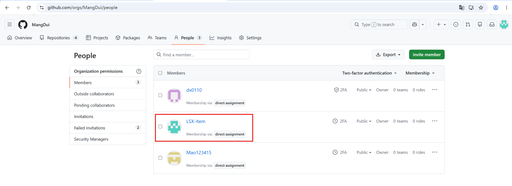
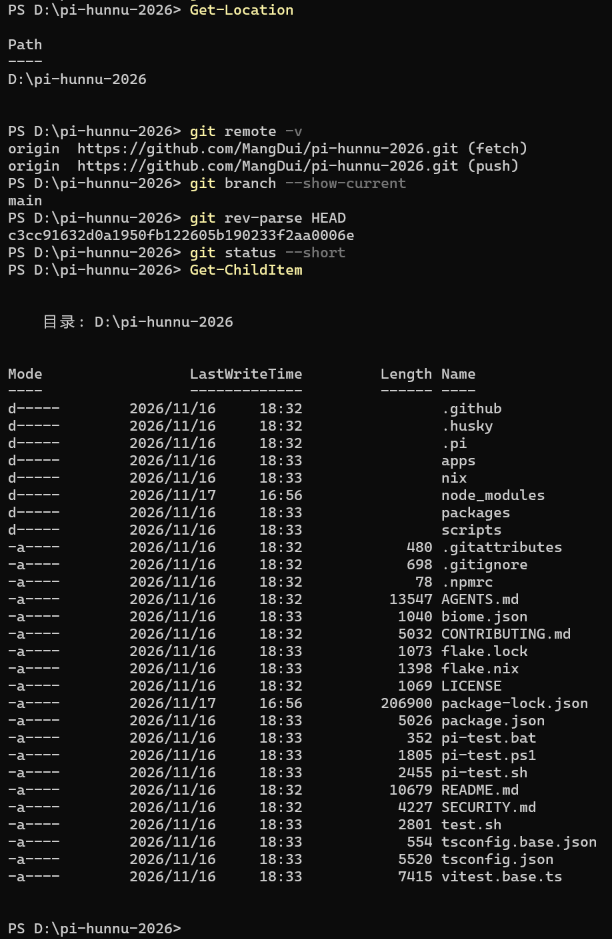
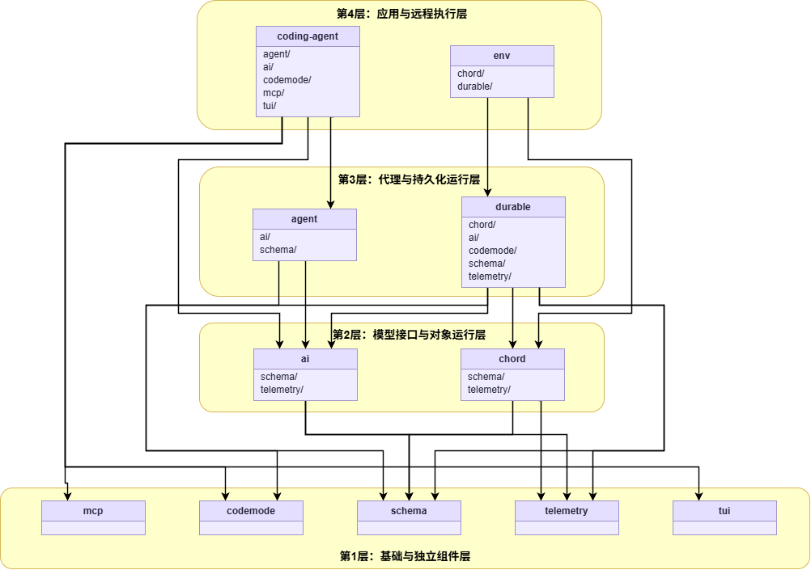

# 实践课 2 · 小组组织建仓与 Pi Agent 源码阅读

| 项目 | 记录 |
| --- | --- |
| GitHub 账号 | `LSX-item` |
| 小组组织 | `MangDui` |
| 分析版本 | `c3cc91632d0a1950fb122605b190233f2aa0006e` |

## 一、小组组织建仓

小组将课程仓库 fork 到 `MangDui` 组织，保留了 `pi-hunnu-2026` 这一仓库名。仓库页标题下方显示了 fork 的来源。组织成员页显示 `LSX-item` 已加入小组，可以在统一的组织仓库中参与后续开发。

- [小组代码仓库](https://github.com/MangDui/pi-hunnu-2026)
- [课程源仓库](https://github.com/hunnuOpenSourceSoftware2026/pi-hunnu-2026)




## 二、下载源码并核对版本

使用 PowerShell 将小组仓库的 `main` 分支下载到 `D:\pi-hunnu-2026`。第一次连接中断，改用 HTTP/1.1 后克隆成功。

```powershell
git -c http.version=HTTP/1.1 clone --branch main https://github.com/MangDui/pi-hunnu-2026.git D:/pi-hunnu-2026
Set-Location 'D:\pi-hunnu-2026'
```

实际 clone 地址：`https://github.com/MangDui/pi-hunnu-2026.git`

| 核验命令 | 本地结果 |
| --- | --- |
| `Get-Location` | `D:\pi-hunnu-2026` |
| `git remote -v` | `origin` 的 fetch 和 push 均指向 `https://github.com/MangDui/pi-hunnu-2026.git` |
| `git branch --show-current` | `main` |
| `git rev-parse HEAD` | `c3cc91632d0a1950fb122605b190233f2aa0006e` |
| `git rev-parse origin/main` | 与本地 `HEAD` 相同 |
| `git status --short` | 无输出，工作区干净 |

S1 截图同时展示了本地仓库根目录的文件列表，其中包含 `packages` 源码目录。



## 三、构建顺序与模块分析

根 `package.json` 用 npm workspaces 管理 `packages/*`、`apps/*` 和部分示例。根 `build` 脚本通过 `cd` 与 `&&` 串联 11 次子包构建，前一步失败会终止后续步骤。以下结果来自固定提交中的脚本和源码，属于静态分析。

```text
telemetry → schema → chord → tui → codemode → mcp → ai → durable → env → agent → coding-agent
```

`packages` 下还包含 `evals`。该包有自己的评估源码，根 `build` 没有调用它，其对 `ai` 和 `coding-agent` 的引用声明在 `devDependencies`。

下表中的“TS 编译”指 `tsc -p tsconfig.build.json`，将 `src/` 下的 TypeScript 编译到 `dist/`，生成 JavaScript、类型声明及映射文件。直接内部依赖以各包 `package.json` 的 `dependencies` 为准，按目录名列出。表中的相对路径均以源码仓库根目录为起点。

| 模块 | 主要职责 | build 与产物 | 直接内部依赖 | 源码依据 |
| --- | --- | --- | --- | --- |
| `telemetry` | 定义可跨后端使用的遥测接口，提供内存采集与空实现 | TS 编译 | 无 | `packages/telemetry/src/metrics.ts`、`packages/telemetry/src/memory.ts` |
| `schema` | 将 JSON Schema 校验规则编译成可复用的校验函数，也提供输入转换 | TS 编译 | 无 | `packages/schema/src/compiler.ts`、`packages/schema/src/coerce.ts` |
| `chord` | 提供跨进程对象运行时，组织文档、契约、存储及连接 | TS 编译 | `schema`、`telemetry` | `packages/chord/src/documents/`、`packages/chord/src/store/`、`packages/chord/src/link/` |
| `tui` | 处理终端输入、组件布局和差分绘制 | TS 编译。原生组件由单独的 `build:native:*` 脚本构建 | 无 | `packages/tui/src/tui.ts`、`packages/tui/package.json` |
| `codemode` | 在受限 JavaScript 运行环境中暴露宿主提供的工具 | TS 编译 | 无 | `packages/codemode/src/runtime/`、`packages/codemode/src/wasm.ts` |
| `mcp` | 建立 MCP 客户端连接，封装协议请求、传输和授权 | TS 编译 | 无 | `packages/mcp/src/client.ts`、`packages/mcp/src/transports/`、`packages/mcp/src/oauth/` |
| `ai` | 统一模型供应商的接口、流式响应和模型目录 | 先生成模型目录，再检查数据、执行 TS 编译，将供应商数据复制到 `dist/providers/data` | `schema`、`telemetry` | `packages/ai/catalog/generate.ts`、`packages/ai/scripts/check-model-data.ts`、`packages/ai/package.json` |
| `durable` | 管理需持久化的会话、任务与文档，封装其存储和恢复 | TS 编译 | `chord`、`ai`、`codemode`、`schema`、`telemetry` | `packages/durable/src/session/`、`packages/durable/src/storage/`、`packages/durable/src/tasks.ts` |
| `env` | 提供远程执行环境客户端，通过 SSH 连接远端守护进程并访问进程、终端等能力 | TS 编译。Rust 守护进程由独立的 `build:daemon` 命令构建 | `chord`、`durable` | `packages/env/src/remote-env.ts`、`packages/env/src/ssh.ts`、`packages/env/package.json` |
| `agent` | 管理代理状态和事件，协调模型响应、工具调用及后续轮次 | TS 编译 | `ai`、`schema` | `packages/agent/src/agent.ts`、`packages/agent/src/agent-loop.ts` |
| `coding-agent` | 把代理核心接入 CLI、交互界面、会话管理和内置编码工具 | `build:unbundled` 编译、设置 CLI/RPC 入口权限并复制主题等资源。随后用 esbuild 在 `dist/bundle/` 生成多个入口及共享分块 | `agent`、`ai`、`codemode`、`mcp`、`tui` | `packages/coding-agent/package.json`、`packages/coding-agent/src/cli.ts`、`scripts/build-coding-agent-bundle.mjs` |

## 四、模块层级与直接依赖

箭头由使用方指向被依赖方。模块框内列出它在 `packages/` 下直接依赖的子目录。第 1 层没有内部运行时依赖，其余模块的层级等于其直接内部依赖的最高层级加一。

| 层级 | 名称 | 模块 |
| --- | --- | --- |
| 第 4 层 | 应用与远程执行层 | `coding-agent`、`env` |
| 第 3 层 | 代理与持久化运行层 | `agent`、`durable` |
| 第 2 层 | 模型接口与对象运行层 | `ai`、`chord` |
| 第 1 层 | 基础与独立组件层 | `mcp`、`codemode`、`schema`、`telemetry`、`tui` |



[可编辑的 draw.io 图源](pi-agent-practice-02/module-dependencies.drawio)

## 五、三个问题

### 1. 根目录与子模块的 build 各读取什么配置？

在仓库根目录执行 `npm run build` 时，npm 从根 `package.json` 读取 `scripts.build`。这段脚本负责调度：先切到 `packages/telemetry`，再按第三节列出的顺序逐个进入子包并调用各自的编译命令。步骤之间用 `&&` 连接，因此其中一步失败，后面的包就不会继续构建。

进入子包后，npm 读取该包自己的 `package.json`。常见命令是 `tsc -p tsconfig.build.json`，其中 `-p` 指定编译配置。以 `agent` 为例，它的配置继承根 `tsconfig.base.json`，以 `src/` 为源码目录、`dist/` 为输出目录，并通过 `paths` 指向 `ai` 已生成的声明文件。编译会产出 JavaScript、类型声明及映射文件。

有两个包的构建还包括数据或发布资源的处理。`ai` 先运行 `generate-models` 刷新模型目录，然后由 `build:offline` 校验模型数据、编译 TypeScript，并把供应商数据放入 `dist/providers/data/`。`coding-agent` 先通过 `build:unbundled` 编译并复制主题等资源，再由 `scripts/build-coding-agent-bundle.mjs` 使用 esbuild 生成 `dist/bundle/`，其中包含 CLI 和 RPC 入口。

### 2. 构建顺序和依赖有什么关系？相邻模块一定互相依赖吗？

依赖关系给根脚本规定了先后约束。以 `durable` 为例，它的 `tsconfig.build.json` 把部分导入指向 `../chord/dist/` 和 `../ai/dist/` 下的声明文件。首次从干净源码构建时，`chord` 和 `ai` 需要先生成这些文件，`durable` 才能解析相应的类型。图上箭头从 `durable` 指向这两个包，而构建时要先处理箭头指向的包。

相邻只表示脚本中的执行位置。例如，`env` 构建结束后紧接着构建 `agent`，但 `env` 声明的内部依赖是 `chord` 和 `durable`，`agent` 声明的是 `ai` 和 `schema`。就这四项依赖约束而言，互换 `env` 和 `agent` 的构建位置也成立，因为它们各自的依赖都已在更早的步骤构建。

### 3. 一条依赖路径中的模块如何分工？

我选取 `coding-agent → agent → ai → schema`，用工具调用参数从模型返回到工具执行的过程来说明。

1. `coding-agent` 在 `packages/coding-agent/src/core/agent-session.ts` 中将代理核心接入编码会话，为工具调用提供会话和工具上下文。
2. `agent` 在 `packages/agent/src/agent-loop.ts` 中处理模型给出的工具调用，先调用 `validateToolArguments`，再把校验后的参数交给工具的 `execute` 方法。执行结果由代理循环整理成工具结果消息。
3. `ai` 在 `packages/ai/src/utils/validation.ts` 中实现 `validateToolArguments`。它从工具定义中取得参数约束，并用 `schema` 提供的 `compile` 创建校验器。
4. `schema` 将 JSON Schema 转成可执行的校验规则。例如，工具规定某字段必填时，缺少该字段的参数会在执行前被发现。

这条路径把编码会话、工具执行流程和参数约束放在不同的模块里。沿着 `agent` 中对 `validateToolArguments` 的调用继续读，就能定位到实际检查参数的代码。
